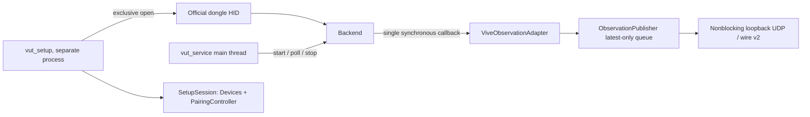
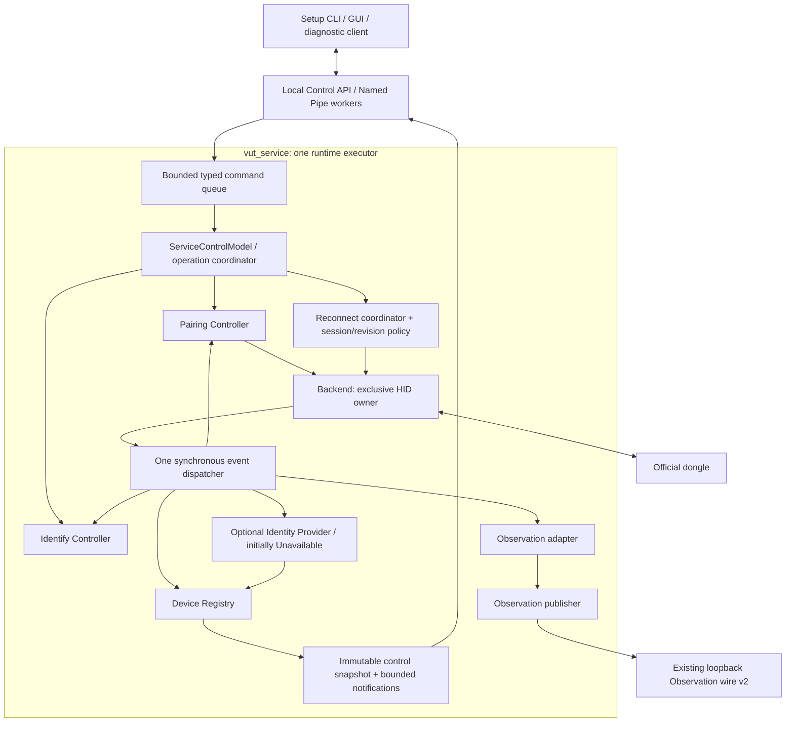

# Altra service-owned control architecture

Design / audit checkpoint: 2026-10-09 JST. **Proposal only; production runtime unchanged.**

Scope authority: attached `MonakaVR_Altra_service_control_architecture_Codex指示書.md`,
SHA256 `903dc855175338e412b6dda87508d121d7418d0acb3667f9efd752a85ac0152e`.
Primary SoT: `orzkwsk/ViveUltimateTrackerBridge`,
`refactor/monaka-layer-separation` at
`a594e4377ef2b5cca04e915187b0c12e59064839` (remote checked on this date).
Design branch starts at that exact commit, without merging the research branch.
Research HEAD was checked as `d78dab2041266cd4cad462bf4784abc3131b556c`;
`d67ac295a29290de5186efead549e7829ff1df29` is also present.

Read this with the [reference audit](altra-service-control-reference-audit.md)
and [minimum work breakdown](altra-service-control-work-breakdown.md).
`CURRENT` below means inspected source at the primary commit; `PROPOSED` means
future behavior requiring implementation and validation. Historical HIL is separately
labelled; none of this task's activities opens HID or sends a device command.

## Decision and responsibility boundaries

Make `vut_service` the sole production HID owner. One runtime executor owns Backend,
reconnect, registry, pairing and Identify lifecycle, adapter and publisher. IPC workers
read immutable snapshots and enqueue validated commands; they never call Backend.
Recommend a Windows Named Pipe with a separate **Altra Control API 1.0**.
Keep direct-HID setup as an explicitly selected bring-up/recovery tool, while the
production setup launcher eventually selects a service client. Identity acquisition
is an optional, initially unavailable provider; its absence must not stop tracking.

The current `vut_service` is a console executable, not an SCM-registered Windows
service. This proposal preserves that deployment initially. Privileged service
installation, account provisioning and session-0 UI bridging require a later decision.

| Responsibility | Owner | Boundary |
| --- | --- | --- |
| Official dongle enumeration, HID open/read/feature exchange, vendor decoder | Backend inside `vut_service` | Preserve Windows HID/SetupAPI, public Backend lifecycle and existing protocol/ACK behavior |
| Transport reopen, Observation session, coordinate revision journal | Tracking Runtime in `vut_service` | Preserve existing strict/preserve policy; control cannot approve a map |
| Current connection/RF/slot, ephemeral handles, accepted pose reception status | Device Registry in `vut_service` | RF/slot are current addressing evidence, never persistent identity |
| PairDevice lifecycle and pending disable | Pairing Controller under runtime executor | Explicit operation only; startup/reconnect must not enable pairing |
| Motion Identify and human confirmation | Identify Controller under runtime executor | Select current device only; no role assignment or identity promotion |
| Physical identity evidence and qualification | Optional Identity Provider under runtime executor | NADS candidate / NASS cross-check; separate stability and acquisition gates |
| Local control contract, authorization, operation records | ServiceControlModel / Local Control API | Backend-specific control version, separate from tracking wire |
| Display, user selection, operation intent | Setup CLI / future GUI | No HID handle, vendor-command passthrough or persistence of RF as identity |
| Shared Observation wire/schema/codec | MonakaProtocol | Consume actual generated/hash-pinned kit; do not redefine |
| Logical mapping, space/profile/calibration routing | MonakaBridge | Existing configuration authority; do not edit or auto-migrate here |
| Body targets, assignment persistence, cross-backend consistency, Main/Fallback, IK/output | MonakaVR | No body-role enum/store/apply API in VUT control |

The actual v2 kit exists at this base. Its manifest pins source
`572e58cfa20b8b4335207ea5dbcb3f04c587ddff`, ZIP SHA256
`a55567425d071e7338b89f4e6caa925676014fd356aa585730deb1f9d11cd7c3`.
Bundled `docs/architecture-revision.md` and `docs/C2.md` supersede historical
Task 3 fixed-C1 identity/modality sections. Control handles and candidate serials
must not replace the current Observation `device_id` as a side effect of this work.
Any future identity mapping/wire change needs owner review and a new actual kit if
the shared contract changes. No such change is proposed for initial control stages.

## Current architecture: code audit



| Audit question | CURRENT finding / code location | Consequence |
| --- | --- | --- |
| A: Backend ownership | `tools/vut_service.cpp::main` owns one stack Backend outside the outer reconnect loop | Reuse one Backend lifetime across reopen; pairing uncertainty currently survives only within that lifetime |
| B: Polling thread | `main` calls start, pollOnce, flush, teardown. Signals only change an atomic run flag. No HID/publisher worker thread | IPC must not add concurrent Backend calls |
| C: Callback fan-out | `Backend::setEventCallback` stores one function; `emit` calls it inline. `snapshot` alone has a state-map mutex | A service dispatcher can fan out, but no built-in multi-subscriber mechanism or general Backend thread safety exists |
| D: Pairing reentrancy | `PairingController::observe` records a matching event; `tick` disables after poll returns. `SetupSession` constructor replaces callback and destructor clears it | Reuse observe/tick discipline; cannot construct SetupSession alongside the service callback unchanged |
| E: Reconnect/control | `pollOnce` read failure attempts disable then stops. `start` increments generation even for failed opens and resolves retained pending disable before success | Service operation coordinator must retire old operations/handles before reopening; no replay of enable |
| F: Pose during setup | Standalone setup polls one open Backend through success and Identify but has no Observation publisher | Same-session fake tests do not establish service-owned publication continuity |
| G: Pairing needs tracking stop? | PairingController has no stop-tracking call; begin/end feature exchange runs synchronously. Configure-on-pair also performs feature exchanges before event emission | Software permits interleaving, but simultaneous tracking/pairing behavior and latency are HIL_REQUIRED |
| Config reload | Service reads configuration once before the outer loop. No file watcher, reload command or re-read on reconnect | A paired/new RF may be visible in registry but not admitted by the configured map. Future reload is a separate proposal |
| Publisher | `src/observation_publisher.cpp`: latest-only keys per device/stream, capacity <=512, default flush budget 8, nonblocking loopback UDP; encode/send failures counted, no retry of old samples | Keep this data-plane boundary; control-client delays must not backpressure it |
| Adapter | `src/observation_adapter.cpp`: explicit configured RF map, generation/epoch checks, duplicate/reorder/gap rejection; configured pair-after-absent requests full session restart | Control cannot bypass admission or suppress required restart to keep pairing alive |
| Shutdown/error propagation | Normal path clears callback, stops Backend and clears publisher. Startup failure logs/retries after 1 s; poll failure re-enters start. Outer exception handler prints text and exits 1; Backend destructor stops | Add typed control outcomes and explicit exception-safe teardown before new callback consumers; stderr is not an API |

Further CURRENT details:

- `BackendConfig::exclusiveHidAccess` defaults **false**; service uses `backend.start()`
  with defaults. Setup sets it true. A single-owner target is therefore a future
  change, not a property already provided by current service.
- `sendCommandDetailed` calls SetFeature and up to ten synchronous GetFeature calls.
  This bounds attempt count, **not elapsed time**. Matching command response is not
  independently verified firmware acknowledgement of every semantic effect.
- `DevicePaired` first updates Backend's slot binding, then runs configureOnPair,
  then emits its event. `DeviceUnpaired` clears slot state, emits the event and
  performs slot-local RxPowerSaving(false). ACK NAZZ triggers FW1 before Ack emission.
  Preserve these paths; no second component should duplicate those commands.
- `Devices` already accepts generation-scoped pair/pose/disconnect, invalidates
  old slot occupants, bounds history to 256, and stores last-seen/last-pose times.
  Its RF-keyed entries are not suitable control handles. Repeated pair resets
  identity/motion; same RF moving to a different slot needs explicit retirement
  in the new registry, rather than treating that RF string as an unchanged object.
- Identify defaults are provisional synthetic-test policy (5 s window, 250 ms
  freshness and tunable motion thresholds). They do not define hardware liveness.
- `StableIdentity`/`observeIdentity` is a receiver for verified input, not an
  acquisition provider. Duplicate/mutation throws today; it does not quarantine
  both devices or keep an evidence ledger. No production provider is connected.
- Service diagnostics run inline, including stderr. New control logging must be
  bounded/off-thread; retaining existing optional stderr does not guarantee bounded
  latency when a redirected stream stalls.

## Target architecture and executor rules



PROPOSED loop invariants:

1. Backend lifecycle, polling, feature commands, registry/operation mutation,
   adapter and publisher have the same executor. No client receives a raw Backend
   reference. Preserve Backend's public start/stop/pollOnce/callback/snapshot API.
2. Register exactly one dispatcher for that lifetime. Within a callback, validate
   generation/time and update registry first; record Pairing/Identify/evidence;
   run existing adapter admission and enqueue. Do not start/end pairing, reopen,
   invoke client code or write to IPC from a callback.
   Record the adapter's actual admission result back into registry publication status
   before exposing the next immutable snapshot; raw-receive age is not admission age.
3. After poll returns, handle transport/session retirement first; finish required
   pairing cleanup; flush data plane; advance timers and process a bounded amount
   of admitted commands. A restartRequired event retires operations, even when
   the HID read succeeded. Tick with a fresh post-poll monotonic time (setup's
   supplied pre-poll time is insufficient for accurate service deadlines).
4. Start with a command capacity of 32, at most one HID-affecting control action per
   loop, four authenticated clients, and one pairing/Identify operation at a time.
   These are software budgets to tune in tests, not vendor timing guarantees.
   Reserve a cleanup/cancel path outside ordinary request-queue capacity. No
   endless queue drain; snapshots are read without dispatching a command.
5. The 50 ms default read timeout only bounds a normal no-data wait. Synchronous
   HID feature calls and cancellation completion can exceed it. Measure those
   before enabling production pairing; a queue alone cannot guarantee high-rate
   tracking. Do not move feature calls to another thread sharing the HID handle.
   If adequate latency cannot be demonstrated, keep concurrent pairing disabled
   and propose a separately reviewed transport state-machine change.
6. IPC encoding, authentication and sends use workers and bounded copies. Slow
   readers are disconnected/resynchronized; they never block HID or UDP flush.
   Validate state again at command execution to prevent admission/execute races.
7. Dispatcher stages isolate optional Identify/provider errors, mark their result
   unavailable/failed and preserve data-plane processing. A core registry consistency
   failure retires control handles and disables mutations; an adapter/session failure
   follows the existing conservative restart path. Never hide inconsistent ownership
   behind a successful response.
8. One exclusive HID open plus one service-instance ownership lock prevents parallel
   owners even with different revision journals. Current launcher process checking
   and the per-journal exclusive lock alone are insufficient. Open contention is
   visible; never fall back to shared access or automatically terminate Hub/tools.

Snapshots remain available when transport is down. A control connection has its own
client lifetime; connecting/reconnecting it never restarts HID or refreshes a pose.

## Device snapshot and runtime handle

The control model is **not a MonakaProtocol schema**. Suggested snapshot:

```text
DeviceSnapshot {
  current_device_handle: opaque token | null,
  record_id: bounded history identifier, actionable: bool,
  service_instance_id, observation_session_id,
  transport_generation, connection_epoch, snapshot_revision,
  rf_address, slot, connection_state, tracking_status_raw, tracking_status,
  last_seen_age_ms, last_pose_receive_age_ms, last_accepted_pose_age_ms,
  pose_freshness: NeverObserved | Fresh | Stale | Unknown,
  freshness_policy_id, publication_admission: Admitted | Unconfigured | Rejected,
  stable_identity: { state, namespace, value_or_redacted, evidence_age_ms,
                     qualification, reason_code },
  pairing_operation_id, identify_operation_id, warning_codes
}
```

Null age means no eligible evidence, not zero age. Include snapshot capture time relative
to a declared service monotonic clock; refresh ages at snapshot read without advancing
sample timestamps. Metadata/ACKs may advance last_seen, never pose age. Track raw pose
receive age separately from usable/admitted pose age so duplicates/reorder or invalid
poses cannot look like fresh tracking. Fresh control reception does not override
Observation admission or guarantee optical validity. RF metadata is local authorized
diagnostic information; identity values are redacted by default.

Choose a **service-local opaque random handle**, backed by a registry entry containing
`(service_instance, observation_session, transport_generation, connection_epoch, RF, slot)`.
Do not use `(generation, RF)` alone: generation resets on process restart and RF can be
reused in the same generation. History `record_id` is never accepted for mutation.

- Mint a new handle on a fresh binding. Pose-first discovery may create an Observed
  entry for reception/Identify, but cannot bind identity without verified connection
  provenance. A pair boundary conservatively retires any previous handle/evidence,
  including repeated same-RF events; track it as a new connection epoch.
- Invalidate on disconnect, slot replacement, same-RF slot change, transport loss,
  Observation-session restart, service restart, or detected ambiguous binding.
  A freshness gap retires Identify evidence; an ownership-ambiguous gap also retires
  the handle. Never infer physical replacement from a gap alone.
- Retire old occupant before installing a replacement; erase all old slot/RF indexes.
  No token reuse. Overflow of any epoch/revision counter fails closed.
- Validate handle and expected service instance at dequeue and again before a deferred
  device action/confirmation. Missing/expired actionable token returns StaleHandle;
  valid current handle with unavailable transport returns TransportUnavailable.
  Read historical metadata through GetDevices, with handle null/actionable false.
- Late device packets have no guaranteed physical-identity epoch in vendor wire.
  An opaque handle solves client ABA, not hidden packet reuse. Retired timestamps,
  observed boundaries and existing packet-index checks are necessary but insufficient
  to invent a firmware liveness guarantee; uncertain associations are quarantined.

## State machines

State labels below are control states, not imported SDK numeric states or wire enums.

### Service

| State | Entry / permitted work | Exit |
| --- | --- | --- |
| Stopped | No HID. This is normally client-observed endpoint absence; an exited process cannot answer GetServiceStatus | Launch -> Starting |
| Starting | Validate config/journal, claim instance/exclusive ownership, open transport | Success -> Recovering; invalid config/journal -> Faulted; unavailable open -> TransportLost |
| Running | Poll/publish; snapshots; mutations only if capabilities and cleanup gate allow | Read loss -> TransportLost; adapter session retirement -> Recovering; shutdown -> Stopping |
| TransportLost | Retire handles/bindings/motion; terminalize operations; status still readable | Scheduled bounded-backoff open attempt -> Recovering; shutdown -> Stopping |
| Recovering | Resolve pending disable first, establish new session/revision via existing coordinator; no enable or identity-query replay | Success -> Running; open/cleanup failure -> TransportLost; fatal journal/config error -> Faulted |
| Stopping | Reject new mutations, cancel queued work, bounded cleanup, clear callback before dependents die, stop HID, clear publisher, stop/join IPC workers | Stopped, with cleanup truth retained if uncertain |
| Faulted | Fatal configuration/journal/consistency failure; mutations disabled, no guessed revision | Explicit corrected restart only |

Recovering never resumes an old pairing operation. A successful reopen updates its cleanup
truth, not its failed outcome. New Observation session is always fresh; coordinate revision
uses current strict default / explicitly configured preserve policy. Identity/handle
invalidation applies even when coordinate revision is preserved. Adapter-driven session
restart is coordinated like transport loss, without claiming a physical USB disconnect.

### Device

Use orthogonal `connection = Observed | Connected | Disconnected | BindingAmbiguous`
and `tracking = Unknown | Initializing | Tracking | Lost`, with separate reception freshness.
This avoids claiming physical disconnection from optical loss or a HID timeout.

| Input | Transition |
| --- | --- |
| Valid pose without connection notification | Observed; current reception visible, identity unavailable |
| Current DevicePaired input | Connected; new epoch; tracking Unknown until new pose |
| Eligible pose with known valid current tracking semantics | Tracking/Initializing/Lost according to existing decoder + validated components; no capability upgrade |
| No eligible pose within declared freshness policy | Pose Stale, motion retired; connection stays observational, no fabricated DeviceUnpaired |
| DeviceUnpaired input | Disconnected; handle/evidence retired; not proof of pairing-database removal |
| Reopen/session change | Old entries Disconnected/retired; current membership starts empty |
| Conflicting live RF/slot ownership | BindingAmbiguous, mutations disabled until fresh unambiguous binding |

### Pairing

Reuse Idle, Enabling, Pairing, Paired, Cancelling, TimedOut, Failed, CleanupFailed as
compatibility display states, but introduce a separate operation outcome and cleanup phase.
Existing Cancelling is also the terminal result of a successful cancel; do not leave the
API waiting for a nonexistent subsequent state.

```text
Idle -> Enabling -> Pairing
Enabling failure -> cleanup -> Failed or CleanupFailed
Pairing + eligible connect -> cleanup -> Paired or CleanupFailed
Pairing + deadline -> cleanup -> TimedOut or CleanupFailed
Pairing + cancel -> Cancelling -> cleanup -> terminal Cancelled or CleanupFailed
Any active phase + loss/restart/shutdown -> cleanup -> Failed/Cancelled or CleanupFailed
CleanupFailed + verified reopened disable -> cleanup Confirmed, old outcome remains failed
```

OperationRecord retains `operation_id`, initiating principal/client lease, selector,
session/generation, start/deadline, event result handle, primary outcome/error,
first cleanup failure, final cleanup status and attempt count. Current controller can
overwrite the primary reason during later shutdown/cancel, and Backend exposes only
lastError. Refactor that reporting narrowly with fake-transport regression before IPC.

### Identify

`Idle -> Collecting -> UniqueCandidate | Ambiguous | NoCandidate -> Confirmed | TimedOut`;
cancel/loss/session retirement -> Cancelled/Failed. UniqueCandidate remains provisional
and can become ambiguous/stale as new samples arrive. ConfirmIdentify requires the same
operation ID, current handle/epoch and one freshly re-evaluated candidate. Confirmation
records a session-local human selection only; it creates neither stable identity nor
assignment. Add CancelIdentify so UI closure has an explicit result. Pairing and Identify
are mutually exclusive initially; Identify sends no tracker command.

### Identity

| State | Meaning |
| --- | --- |
| Unavailable | Provider absent, missing current evidence, unverified acquisition, or partial burst policy not approved |
| Candidate | Future opt-in evidence parser saw current bytes; qualification still Class B/HIL_REQUIRED |
| Verified | Reserved for independently reviewed Class A provider and current acquisition/binding policy; **never emitted by present production** |
| Ambiguous | Duplicate candidate on live bindings, mutation/cross-check conflict, overlapping/uncertain ownership; quarantine all affected bindings |
| Stale | Historical evidence retired by a connection/session/generation boundary; no current stable binding |

With the provider absent, GetIdentityStatus returns OK with state Unavailable and reason
ProviderNotInstalled. Candidate/Ambiguous/Stale are contract states for future evidence
integration or fake tests, not claims that current service implements them. Ambiguous
identity does not automatically stop unrelated RF tracking, but forbids stable mapping.

## Pairing versus tracking and reconnect

PROPOSED operational policy is **continue polling/publication**, without a guaranteed
hardware outcome. Initially advertise `pairing_supported=false` for production service
until concurrent behavior, synchronous call latency and cleanup gates pass. Return
Unsupported; do not implicitly stop tracking or launch direct-HID setup to compensate.

| Concern | Design rule / remaining evidence |
| --- | --- |
| Enable while existing trackers track | Serialize enable between polls. Never hold the callback/IPC lock over feature calls. HIL must establish effect on existing trackers and poll gaps |
| Reconnect during pairing | Reconnect is never blocked by a control lease. Loss/required session restart aborts pairing; new generation rejects queued old commands; no enable replay |
| Pair-event ordering | Backend currently configures before emitting. Dispatcher updates registry before recording pairing success; tick disables after poll returns; reply says complete only after cleanup truth is known |
| Existing tracker reconnects in selected slot | Current controller accepts the first in-window selected DevicePaired, not proof of a newly paired physical tracker. API returns an observed connection result; exclude pre-existing live bindings where possible and require user verification, never assert registration created |
| Pair success/timeout/cancel | Use current bounded endPairingWithRetry plus final stop safety path. No invented unpair/remove-all command; failed disable blocks new control enable |
| RF or slot changes | Retire old handle/motion/identity; new binding does not inherit map or assignment from slot/order |
| New map admission | Registry lists all observed devices, but adapter still requires explicit configured RF map. Report Unconfigured; do not auto-add, rename or assign a map |
| Configured re-pair after absent | Existing adapter requests session restart, possibly interrupting all publication. Coordinator cleans/terminalizes the operation before that restart. This limitation remains until separately reviewed; no promise of uninterrupted multi-tracker pairing |
| Publisher failure/client disconnect | UDP errors remain counters; client lease loss requests cancellation but does not end tracking/HID ownership |

Loss scenario: mark operation Failed(TransportLost) and invalidate handles immediately;
reuse Backend's still-open disable attempts; after poll returns record cleanup truth,
close/reopen on the runtime executor. If pending disable is unresolved, stay gated in
Recovering/TransportLost. On verified disable, record a cleanup-status update and start
fresh tracking session; old success is not resurrected. A posted identity acquisition
intent is equally invalidated and is not retried on a different binding automatically.

Process crash is different from in-process reopen: current pending pairing flag is only
memory. A future production pairing release must durably record possible enable and
selector **before** sending, and confirmed disable afterwards, in an independent local
control-recovery journal. Journal is tied to the provisioned dongle/installation; do not
apply it blindly to a replacement dongle. Corrupt/missing binding or uncertain crash
recovery leaves mutations unavailable and needs explicit recovery. Startup never guesses
an all-slot reset/enable. Disable replay across a crash requires separately verified
dongle targeting and safety policy. This is a release blocker, not implemented persistence.

## Identity acquisition integration seam

Future flow: `BackendEvent::Ack -> byte-preserving IdentityEvidence parser -> optional
IdentityProvider -> Device Registry -> control snapshots`. At this base Ack carries
raw payload bytes in `std::string text`, RF/slot, receive timestamp and generation;
it has no immutable raw-report reference or connection epoch. Proposed dispatcher
attaches the current validated epoch/session; raw provenance needs a narrowly reviewed
Backend evidence seam if the qualified provider requires it. Do not infer those missing
fields from v1 wire, a slot cache or a Hub database.

Internal evidence retains namespace, exact bytes, service instance/Observation session,
transport generation, connection epoch, RF/slot, receive timestamp, parser/provenance
version and source/reference. Validate evidence after current connect and retire at
disconnect/replacement/reopen. ACK-before-pair or ambiguous ownership is unbound evidence,
never silently bound later. Historical bytes may support reviewed enrollment comparisons
but cannot restore a current RF association.

NADS primary + independently qualified NASS cross-check is the preferred future policy.
Initially missing either member is Unavailable; no NASS fallback, guessed concatenated
key, trimming/case-folding, namespace equality assumption or cache-derived live identity.
Duplicate live namespace/value quarantines both devices. Mutation/conflicting enrollment
requires explicit review. Define acquisition deadlines/late-evidence behavior only after
verified trigger and freshness investigation; observed burst durations are not a TTL.

Research evidence remains Class B/HIL_REQUIRED: A had unchanged candidates after changed
RF/slot, B's corresponding post-pair evidence is incomplete; restart/reopen alone did not
reliably rediscover identity in saved windows. Passive research suppressed configure-on-pair,
NAZZ->FW1 and PWS recovery; its failure observations do not prove normal service behavior.
SDK tracker name is not correlated to NADS/NASS. **NA remains DO NOT SEND.** There is no
AcquireIdentity/RefreshIdentity active-query API in v1; capability stays disabled until
acquisition is independently qualified. No StableIdentity receiver is called in this task.

## Control API proposal

An implementation-owned backend-local contract, independent of MonakaProtocol codecs.
First exchange is Hello(version range); response identifies selected version, service
instance, clock and capability flags, including gated Pairing/Identify/provider support.
Every mutation carries expected service instance and an idempotency request ID.

```text
Request  { api: "altra.control", major: 1, minor: 0, request_id,
           expected_service_instance, operation, arguments }
Response { request_id, service_instance, snapshot_revision, code, reason_code,
           retryable, operation_id?, result?, cleanup_status?, diagnostic_id? }
Operation { id, kind, outcome: Pending|Succeeded|Cancelled|TimedOut|Failed,
            phase, primary_error, cleanup: NotNeeded|Pending|Confirmed|Unconfirmed,
            first_cleanup_error, deadline, result_handle?, qualification }
```

OK on Begin means **accepted**, with Pending operation; it is not physical success.
Responses have bounded structured errors; diagnostic strings are optional/redacted and
never drive client branching. Reads return snapshots even when an operation failed.
All proposed numeric limits here are local software limits, not tracking-wire limits.

| Operation | Input -> result | Decision |
| --- | --- | --- |
| GetServiceStatus | none -> service/transport/publication health, config fingerprint, capabilities, queue/cleanup status | Keep; read-only, no HID query |
| GetDevices | bounded page cursor/include_retired -> consistent device page + revision | Keep; cursor tied to revision; retry snapshot if revision changes |
| GetDevice | current handle -> DeviceSnapshot | Keep; invalid token StaleHandle |
| BeginPairing | selector all or 0..4, timeout 1..3600 s (default 60 s) -> operation ID | Keep, HIL/recovery gated; selector is diagnostic/addressing scope, not tracker identity |
| CancelPairing | operation ID -> updated operation/cleanup status | Keep; idempotent, can request cleanup for an unresolved owned operation |
| GetPairingStatus | operation ID -> Operation | Keep; GetServiceStatus identifies latest/active ID |
| BeginIdentify | eligible current handle set or all eligible devices -> operation ID + declared policy | Keep, provisional qualification; Busy during pairing |
| GetIdentifyStatus | operation ID -> candidates, ages/ambiguity/phase | Keep; no high-rate pose coordinates |
| ConfirmIdentify | operation ID, current candidate handle -> human selection record | Keep; freshness/uniqueness revalidated; no identity or role write |
| CancelIdentify | operation ID -> terminal Cancelled | Add explicit lifecycle symmetry |
| GetIdentityStatus | current handle -> identity state, qualification, evidence ages/reasons | Keep; unavailable is a valid state, not a fake stable ID |
| GetDiagnostics | bounded category/page -> counters + sanitized recent summaries | Keep passive; no raw commands, full ACKs, unrestricted filesystem paths or active queries |
| Subscribe / Unsubscribe | topics, last revision? -> subscription token / resync_required | Optional capability; polling always available |

Do not include Unpair, map reset, power/restart, body assignment, config migration,
NA/raw feature send or vendor-command passthrough. Future operations need separately
reviewed semantics, permissions and version/capability negotiation.

One dongle-wide pairing lease; initially one Identify lease, mutually exclusive with
pairing and future HID identity operations. Concurrent Begin returns Busy. Authenticated
readers can inspect public operation summaries; only the initiating principal/lease may
cancel/confirm, with an explicitly configured recovery administrator permitted to cancel
pending cleanup. IDs are not authorization. A disconnect posts prioritized cancellation;
service continues cleanup and retains a bounded terminal record. No ownership transfer
by guessing an ID; a returning client uses its authenticated lease token.

Deduplicate mutations by principal, service instance and request ID for the instance
lifetime within a bounded window (initially 128 results / 10 minutes). Same key and
different arguments -> InvalidArgument. Echo the original operation for retransmission;
clients cannot assume exactly-once after expiry/crash. After IPC timeout/disconnect,
query status rather than issue a fresh Begin. Do not evict an active operation to admit
new work. Expired operation record -> Unavailable(OperationExpired), requiring a new
snapshot; no automatic replay. Terminal history cap initially 64 with expiry advertised.

### Failure semantics

| Code | Meaning / client action |
| --- | --- |
| OK | Read complete or operation accepted; inspect outcome/cleanup for final success |
| Unavailable | Requested data/operation record unavailable; e.g. NoCandidate, OperationExpired. Provider absence is reported in identity state |
| Busy | Exclusive operation/queue capacity occupied; retry after status, no implicit cancel |
| InvalidArgument | Selector, size, timeout, fields or confirmation invalid; fix input |
| StaleHandle | Old/unknown actionable binding or wrong expected service instance; fetch current snapshot; never retarget by RF/slot |
| TransportUnavailable | Service is reachable but HID/recovery unavailable; observe status, do not launch direct HID |
| OperationFailed | Accepted operation terminated unsuccessfully; primary reason remains available |
| CleanupUnconfirmed | Disable not confirmed or crash recovery uncertain; block new HID mutations, allow reads/cancel/status |
| Unsupported | Operation/capability/major version unavailable; no fallback execution |
| PermissionDenied | Authenticated caller lacks mutation/diagnostic scope (add to required minimum set) |

Validation precedence: authentication/version/framing, argument validation, service
instance/handle validation, unresolved cleanup, capability availability, transport state,
operation/queue Busy. This makes stale selection visible before any device side effect.
Read status is still OK for TransportLost. GetPairingStatus returns OK plus failed
operation; the initiating completion notification reports OperationFailed or
CleanupUnconfirmed as appropriate. Preserve primary failure even if cleanup later succeeds.
Client-side endpoint absent/pipe closed is a separate connection error, not a fabricated
service response. No stack trace/raw payload in protocol errors.

## IPC transport, security and versioning

| Transport | Security / complexity | Events / reconnect / diagnostics / tests | Portability and GUI/CLI | Decision |
| --- | --- | --- | --- | --- |
| Named Pipe | Explicit Windows DACL and remote rejection; moderate overlapped I/O/lifecycle work | Duplex stream; bounded framing; real pipe tests; clean disconnect | Native Windows clients; later Unix-domain transport adapter | **First choice** |
| localhost TCP | Bind loopback only; local user authentication needs separate token/peer policy; moderate | Reliable stream, easy tooling/fake server; partial framing/retry needed | Portable, many UI libraries | Viable later, no unauthenticated port |
| localhost UDP | Loopback is not user authorization; low setup cost but custom reliability | Loss/reorder/retry/duplicate command risk; unsuitable mutation completion | Portable | Keep existing pose UDP separate; reject for control |
| shared memory | ACL + ownership/generation + synchronization; high complexity | No built-in disconnect/commands; difficult crash cleanup/diagnostics | Platform-specific | Unnecessary for low-rate control |
| loopback HTTP | Token/session/Origin protections and server dependency; moderate/high | Request tooling good; SSE/WebSocket for push; extra lifecycle | Good browser GUI support | Later adapter if needed; no browser-exposed control initially |
| custom binary socket | Inherits socket authentication problems plus custom codec cost | Compact but harder inspection/evolution | Portable clients need codec | No advantage for low-rate control |

PROPOSED framing: duplex byte pipe, 4-byte little-endian payload length plus UTF-8 JSON;
max 64 KiB payload, reject zero/oversized lengths before allocation, strict duplicate-key,
UTF-8/depth/type validation, 5 s partial-frame timeout. Worker handles split/coalesced
frames. Do not reuse tracking envelope framing/codec or its size limits. Initial depth
limit 16, GetDevices page <=32, at most four clients, bounded outbound budget 256 KiB per
client. Exceeding budget emits resync if possible or closes that client; no HID blocking.

Use an explicit DACL for the provisioned runtime account and authorized user/logon SID;
no Everyone/anonymous/default DACL. Pairing requires authenticated mutate permission.
Choose local-only pipe with PIPE_REJECT_REMOTE_CLIENTS, overlapped I/O and server-instance
ownership; deny clients pipe-server-instance creation rights. Verify endpoint ownership
on the client and caller token/session on the service; pipe name is not authorization.
Local elevated administrators are trusted under this OS model. These proposals follow
Microsoft's [pipe security guidance](https://learn.microsoft.com/en-us/windows/win32/ipc/named-pipe-security-and-access-rights).

The [CreateNamedPipe API](https://learn.microsoft.com/en-us/windows/win32/api/winbase/nf-winbase-createnamedpipea)
documents remote rejection, first-instance and overlapped modes; use overlapped I/O,
not PIPE_NOWAIT as an asynchronous implementation. Disconnect cancels outstanding I/O;
worker buffers/OVERLAPPED live until cancellation completes. Do not join workers from
inside Backend callbacks. Future Linux can use a permissioned Unix-domain socket with
peer credentials while sharing the ControlModel/contract, without adopting vendor SDK wire.

Initial deployment is one explicitly provisioned local user/session controlling one
runtime instance/dongle. Other local sessions have no access by default. Machine-wide
SCM mode would need an authorized-session policy; do not let the first connecting client
select it. Raw serial values and ACK/RF diagnostic exports require explicit diagnostic
scope and redaction policy; never expose private HIL captures via GetDiagnostics. Future
power/reset/restart operations remain Unsupported even for administrators in v1.

Control major/minor are independent of Observation wire 2.0. Reject unsupported major
at Hello, use negotiated minor/capabilities, tolerate documented optional response fields
within a major, and never silently ignore unknown mutation arguments. Additive optional
status fields/topics may be minor changes; altered required fields, meaning or framing
need a new major/endpoint. Unknown operations return Unsupported without execution.
Store golden control fixtures separately from MonakaProtocol fixtures in future work.

## Event subscription and clients

Recommend hybrid: initial full snapshot, coalesced control events and periodic status
refresh. Polling fallback at 2 Hz while interacting (5 Hz briefly for an active operation),
1 Hz when idle; coalesce device/health state push to <=5 Hz/client. Operation completion
and cleanup updates are priority low-volume events. These are UI budgets, not firmware
latency guarantees. Never transmit high-rate pose samples on this API.

Every snapshot/event has service instance and monotonic control revision. Subscribe
establishes a snapshot revision and stream cursor atomically; no gap between initial
snapshot and subscription. Revision counters are unrelated to map revision, packet index
and wire sequence. Retain a bounded event window; overflow/new instance yields
ResyncRequired rather than pretend complete replay. Client reconnect obtains Hello and
fresh snapshot, invalidates all cached handles when instance/session changed, and queries
its operation's recorded outcome. A silent slow client loses notifications, not data-plane
ownership. Pose ages are refreshed in polling responses without generating per-pose events.

| Setup future | Benefits / cost | Choice |
| --- | --- | --- |
| A: direct HID only | Retains bring-up but still competes with production | Insufficient production workflow |
| B: IPC only | Clear ownership but loses isolated recovery path | Too early while service control/acquisition remain gated |
| C: production IPC client plus explicit direct bring-up mode/tool | Preserves diagnostics with clear mode and ownership; more frontend maintenance | **Recommended** |

Initially introduce `vut_setup_client` alongside unchanged `vut_setup`. Later switch
`scripts/setup_altra_trackers.ps1` to the service client after software and physical gates;
retain a separate explicit bring-up launcher/tool. Do not silently fall back to direct
HID when service endpoint is absent. Direct mode requires service/Hub ownership released
and exclusive open; it never kills processes or becomes a second production owner.
No future GUI is built here. SetupConsole command parsing/messages are reusable only
after extracting a ControlClient interface from its current concrete SetupSession coupling.

## Testing, blockers and migration gates

Hardware-free tests must assert command count/order, immutable primary failure, handle
retirement and publication continuity under synthetic events, not merely mirror struct
layouts. Planned cases and implementation files are in the work breakdown. Current fake
transport tests disable configureTrackingOnPair; they cannot qualify production latency
or PairDevice's effects on existing trackers. Actual Named Pipe authorization/cancellation
tests prove Windows IPC behavior only; they are also separate from dongle HIL.

Release blockers:

1. Concurrent pairing/tracking effects and HID feature-call latency are unknown. Existing
   adapter re-pair restart can interrupt all devices; preserve it until separately justified.
2. Exclusive service ownership and instance lock need platform tests and later HIL;
   current shared-open behavior must not be described as single-owner production.
3. Durable crash cleanup needs verified target dongle identity/recovery policy. In-process
   retained cleanup alone is inadequate for production pairing.
4. NADS/NASS stability is Class B and acquisition remains unresolved. No active refresh
   request is verified. Identify thresholds require separate physical evaluation.
5. Newly paired RFs lack automatic approved map admission. Config reload/migration and
   a config-free full workflow are not delivered by local IPC.
6. Upper body assignment exists in MonakaVR, but no reviewed VUT physical-identity-to-
   logical-tracker/apply adapter contract exists. Do not treat logical naming as a role.
7. IPC deployment principal/session policy, bounded JSON parser choice and measured
   shutdown budgets need implementation review. No Windows service installation assumed.

Migration: (1) pure ControlModel/handles and failure records, (2) passive service dispatcher
and registry, (3) fake-tested pairing/Identify integration with mutation capability off,
(4) read-only Named Pipe + security/version tests, (5) service setup client plus later
explicitly authorized HIL/recovery qualification before enabling mutations/launcher cutover,
(6) independently qualified optional identity provider, (7) owner-reviewed Monaka assignment
adapter contract. Stages 1-5 do not depend on verified identity, while persistent assignment
does. Keep commits small, feature-gated, with current direct bring-up available. Rolling
back control disables endpoint/mutations and restores launcher selection explicitly; never
roll back the coordinate journal or replay an old operation/session. No automatic migration.

This design may be reviewed/merged as documentation. It does not authorize implementation,
HIL, active queries, wire changes or a production cutover. Validation results for this
documentation checkpoint are recorded in the work breakdown; hardware remains NOT RUN.
