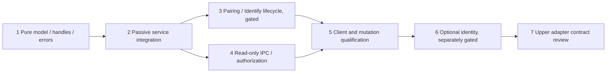

# Altra service control: minimum implementation work breakdown

This is a work proposal after the [design/audit](altra-service-control-architecture.md),
not authorization to begin runtime work. Current delivery changes documentation only.
Future runtime changes stay in `orzkwsk/ViveUltimateTrackerBridge` on small feature
branches derived from the reviewed `refactor/monaka-layer-separation` lineage. Proposed
branch names below are planning identifiers; none is created by this task. Reconfirm
base ancestry and current user scope before future work. Do not merge research code
or alter MonakaProtocol/MonakaBridge/MonakaVR as part of these steps.

## Minimum dependency graph



Implement 1-5 without a StableIdentity provider. Each item is sized to split into a
model/test commit and a thin integration commit where necessary. Never combine wire
changes, body policy, undocumented commands or automatic config migration with them.

| Step / target branch (proposed) | Repo / files to change | Expected behavior / exit gate | Software tests required | HIL / platform gate |
| --- | --- | --- | --- | --- |
| 1. Pure control model / `feature/altra-control-model` | Primary; new `include/vut/service_control.hpp`, `src/service_control.cpp`, `include/vut/device_registry.hpp`, `src/device_registry.cpp`, `tests/service_control_tests.cpp`, `tests/device_registry_tests.cpp`, CMake registration | Typed errors/operations/snapshots; immutable primary and cleanup failures; opaque handles mapped to complete binding epochs; no HID/IPC/provider connection | Inject events/clock; service restart with same generation; slot reuse; same-RF slot change; repeated pair; old queued handle; history/counter/queue exhaustion; raw versus accepted pose age | No HIL needed for pure model; does not establish physical replacement detection |
| 2. One passive owner / `feature/altra-service-control-owner` | Primary; `tools/vut_service.cpp`; new `include/vut/service_runtime.hpp`, `src/service_runtime.cpp`, runtime tests; existing `src/setup_session.cpp` interface only if needed; CMake | One callback dispatcher, registry-first ordering, immutable snapshots; same executor for Backend/adapter/publisher; provider Unavailable; preserve existing adapter restart/revision behavior; propose exclusive open + instance lock without shared fallback | Fake transport plus actual adapter/publisher; callback replacement regression; consumer failure; shutdown/exception ordering; transport reopen/new session; command flood cannot starve synthetic pose admission; no startup PairDevice/query | Windows instance/exclusive-open tests using fake/platform handles first. Actual dongle/Hub contention and tracking regression HIL deferred; no production ownership cutover without it |
| 3a. Controller reporting / `feature/altra-control-lifecycle` | Primary; `include/vut/pairing.hpp`, `src/pairing.cpp`, new runtime/control tests; `tests/fake_pairing_transport.hpp`, `tests/setup_pairing_tests.cpp`; Identify controller extraction from `src/setup.cpp` | Preserve begin/end/ACK payloads and observe/tick discipline; capture original outcome/first cleanup error; operation-specific cancel/confirmation, fresh post-poll clock; no automatic identity/role inference | Enable exception after write, response missing/malformed, cancel/timeout, selected old connect versus new candidate, loss/adapter restart, late event, stale Identify confirmation, ambiguous/no candidate | Hardware NOT needed to validate reporting; Pairing and Identify physical correctness remain HIL_REQUIRED |
| 3b. Runtime operation coordinator / same branch or follow-up | Primary; new reconnect/control coordinator and control-recovery journal files; `tools/vut_service.cpp`; tests; `src/backend.cpp` only for a narrowly reviewed evidence/error seam, public Backend lifecycle preserved | Serialize commands, cleanup/cancel priority, retained failed operation after reopen; mutation capabilities default off. Define crash recovery target/persistence before exposing production pairing | Fake open/read loss, partial enable/disable, cleanup pending reopen, journal failure before write, process crash at write/confirm boundary with no actual HID, different provisioned dongle, corrupt journal, shutdown mid-operation | Durable replay safety and provisioned dongle identity are unresolved. No production pairing enable until separately authorized HIL and recovery policy review |
| 4. Read-only Control API 1.0 / `feature/altra-control-ipc` | Primary; new `include/vut/control_protocol.hpp`, `src/control_protocol.cpp`, `src/control_pipe_win32.cpp`, IPC tests/fixtures; CMake; service integration | Hello/capabilities, status/devices/identity/diagnostics, version negotiation, passive snapshots, optional hybrid subscription. No active device query. Use explicit DACL/remote rejection and bounded workers | Fake stream for split/coalesced/truncated/oversized/duplicate-key/bad UTF-8/type/version requests; real Windows pipe tests for denied caller/session, endpoint ownership, partial-frame deadline, client close/slow reader, overflow/resync, shutdown cancel/join | No dongle HIL for IPC. Real Windows ACL/cancellation verification mandatory before claiming secure local operation; Linux adapter optional future work |
| 5a. Service setup client / `feature/altra-setup-service-client` | Primary; new `tools/vut_setup_client.cpp`, client interface; `src/setup_console.cpp`, header; client/CLI tests; explicit future launcher selection in `scripts/setup_altra_trackers.ps1`, bring-up launcher docs | Production frontend uses service snapshots/handles, never opens HID; explicit bring-up path retained. No silent direct-HID fallback; unavailable identity and unconfigured map clearly displayed; no role operations | Fake service server, denied endpoint, stopped service, stale service instance, idempotent Begin retry/status query, client reconnect/disconnect cancel, Identify policy/confirm, malformed replies; launcher static/process mocks | No HIL for CLI parser/client tests; do not switch default launcher until runtime/ownership/operations have passed qualification |
| 5b. Mutations / production cutover gate / follow-up to same branch | Primary; capability policy/config and authorized runtime/launcher changes, evidence docs; no new vendor command | Enable Begin/CancelPairing and Identify only after measured timing/recovery qualification; keep existing map admission and wire v2. If interleaving fails, leave pairing Unsupported and propose narrow transport work | Fake production configure-on-pair/NAZZ/PWS sequences while publisher runs, request/cleanup saturation, competing clients/leases, operation-status retention, config unconfigured RF, full existing regressions | Separately authorized HIL: existing tracker poses through enable/new connect/disable; multiple trackers; latency/gaps, timeout/cancel, tracker power loss, dongle loss, re-pair/adapter restart, shutdown/cleanup and process recovery. Identity is not a prerequisite for tracking/control release |
| 6. Optional identity provider / `feature/altra-identity-provider` (deferred) | Primary only; new evidence parser/provider files and tests; reviewed Backend evidence seam and control status integration | After Class A stability + acquisition review, exact-byte NADS primary/NASS check, current-epoch binding, duplicate/mutation quarantine. Before qualification state remains Unavailable; never call receiver with unverified candidates | Fake ACK provenance, before-connect/retired/out-of-order data, duplicate both bindings, partial burst, mutation, stale/late evidence, reconnect without serial; software tests never promote qualification | Blocked on fresh B post-pair observations, reliable isolated startup/reconnect acquisition, verified safe trigger/deadlines and enrollment policy. NA prohibited; no provider connection in present task |
| 7. Assignment adapter contract / branch name TBD after upper-owner review | Primary documentation proposal only; upstream interface ownership discussed with MonakaVR/Bridge/Protocol owners, **no other-repo changes here** | Specify verified physical identity -> logical tracker relation and user selection handoff. Upper layer owns body targets/Main/Fallback/IK/persistence. Implement only when an authoritative adapter/apply contract is approved | Future contract fixtures should distinguish persistent logical/physical identity from runtime handle; integration tests separately scoped by owners | Deferred; identity/provider/upper contract gates. Any shared wire change requires actual new hash-pinned kit; map/body calibration HIL is outside VUT control scope |

## Meaningful software test matrix for implementation

| Scenario | Required assertion |
| --- | --- |
| Fake Backend / transport | No real HID opened; normal startup/reconnect emits no PairDevice enable; command effects and limits observable |
| Pair lifecycle under pose traffic | Registry update precedes controller result; disable outside callback; synthetic existing-device Observation continues; no duplicated configure/PWS/FW commands |
| HID loss / adapter restart | Active operation fails, cleanup truth preserved, publisher old session cleared, new session cannot accept old commands/events |
| Stale handle / slot reuse | A's token cannot confirm/operate B even with identical slot or reused RF; same generation and process restart cases covered |
| Registry reception / optical loss | Metadata/duplicate/reorder cannot refresh accepted-pose age; optical loss/receive timeout does not fabricate disconnection |
| Identity duplicate / stale | Both conflicting live bindings quarantined; retired bytes/cache cannot rebind; fake provider only, no Class A assertion |
| Client reconnect / reply loss | Same request returns original operation within retained window, no extra enable; reconnect does not reopen HID; instance mismatch invalidates selection |
| Authentication / malformed request | Wrong principal/version/fields/length fails before enqueue/HID; no diagnostic raw-value leak; authorization checked for cancel/confirm as well as Begin |
| Shutdown mid-operation | Reject new mutations; prioritized cancel; bounded attempts; original failure survives; callback cleared before model destruction; workers joined; unconfirmed cleanup persists honestly |
| Slow client / flood | Per-client memory and command work bounded; notifications require resync on overflow; published poses and cleanup advance without client I/O on owner |
| Crash recovery | Fake/process fixture verifies write-ahead intent and no speculative operation replay against changed/unknown dongle; no manual deletion/reset of journals |

## Hardware qualification is a separate later task

The HIL column is a dependency list, not a procedure being executed now. Do not run any
service/probe/pair/capture/launcher against hardware as a side effect of these design
checks. Preserve missing/failed results, firmware/OS/dongle conditions, actual source
and binary hash, per-device observations and private/sanitized evidence distinction.
Existing synthetic PASS and historical narrow PWS/identity observations cannot satisfy
service-owned concurrent pairing, crash recovery or production acquisition gates.

Identify is motion-based and passive, but policy qualification still needs physical
stationary/noise/slow/normal-motion and ambiguity trials. Tracking freshness and optical
validity must remain separate. If pairing perturbs host/map/session state, retain the
conservative gate rather than claim continuity or silently change protocol/map policy.

## Current design-task validation receipt

Environment: Windows x64, Visual Studio 18 2026, MSVC 19.51.36260.0,
Windows SDK 10.0.26100.0, Python 3.13.15, Java 17.0.20 explicitly selected.
Fresh ignored build directory: `build/service-control-audit`.

Commands run from the repository root (CMake/CTest resolved to the Visual Studio
`Common7/IDE/CommonExtensions/Microsoft/CMake/CMake/bin` installation):

```text
cmake -S . -B build/service-control-audit -A x64 -DBUILD_TESTING=ON -DVUT_BUILD_OBSERVATION=ON -DJava_JAVA_EXECUTABLE=<installed JDK17>/bin/java.exe -DJava_JAVAC_EXECUTABLE=<installed JDK17>/bin/javac.exe
cmake --build build/service-control-audit --config Release
ctest --test-dir build/service-control-audit -C Release --output-on-failure --no-tests=error --output-junit design-sandbox-results.xml
ctest --test-dir build/service-control-audit -C Release --rerun-failed --output-on-failure --output-junit design-host-rerun-results.xml
```

Configure and full Release build: **PASS**. Configure verified the actual v2
artifact/manifest/clean-source/contract/content hashes and historical fixed v1 provenance.
Initial sandbox CTest: **11/16 PASS**, five failures (assignment atomic replacement,
temporary file permissions/cleanup and UDP loopback timeout). This is a retained failed
run, not a PASS. Host rerun of exactly those five failures: **5/5 PASS**, 1.12 s.
Thus **all 16 distinct existing software tests passed across the two runs**, including
Windows fake-HID setup/backend lifecycle, adapter/publisher/session, offline CLI,
launcher process mocks, protocol integrity, UDP and C++/Java cross-language validation.
JUnit receipts and LastTest.log remain under the ignored build directory. No repeated
tests beyond the environment failures were needed. No new runtime tests or executable
fixture are added for this documentation-only change.
Documentation checks: all four relative links among the three deliverables resolve;
staged whitespace check passes. The staged file list contains exactly these three
Markdown documents; diff against the primary base is empty for runtime, tools,
scripts, CMake, third-party kits and dependency manifests.
Design-state machines, IPC, runtime handles and crash journal have **NOT BEEN IMPLEMENTED**;
passing current tests is baseline evidence only.

Hardware, active query, HIL, production IPC, provider connection, MonakaProtocol/Bridge
changes: **NOT RUN / NOT IMPLEMENTED**, intentionally outside this task. No launcher
or hardware entry point was executed. Existing tests use fake transport, offline setup,
service `--check-session` (test journal without HID), synthetic process records and loopback.

Only these three documents may be staged. Attachment directory remains untracked.
`hil-private/` becomes untracked on the primary-derived design branch because its ignore
rule exists only in the research branch; preserve it unchanged and never stage it.
Build outputs/logs stay ignored. Do not add an ignore/runtime/research change merely to
make working-tree output look clean. Final receipt should state these preserved files.

Merge recommendation: documentation review is appropriate; production cutover is NO-GO.
Implementation starts only in a subsequently authorized scope, with blockers above explicit.
